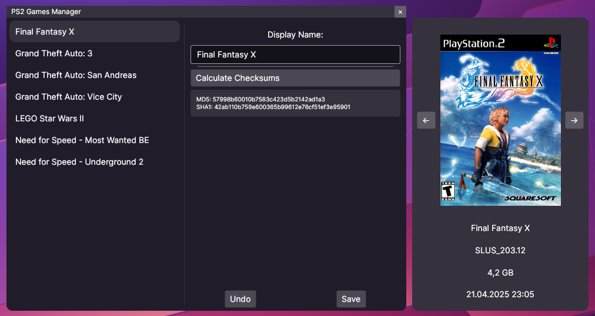
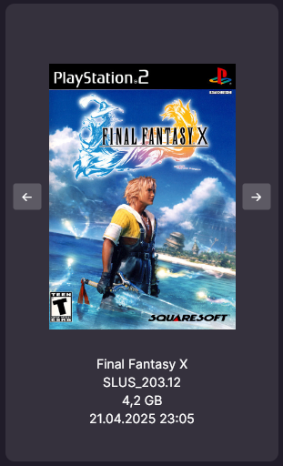

# OPLNova

Modern, open-source alternative to OPL Manager for managing PS2 games with Open PS2 Loader (OPL).

[](https://code.weexnes.dev/oplnova/~builds)
[](https://aur.archlinux.org/packages/oplnova)
[](https://aur.archlinux.org/packages/oplnova-git)
[](LICENSE)

OPLNova is designed to give a more streamlined and user-friendly experience for managing your PS2 games with OPL.
It lets you organize and manage your PS2 game collection, with features such as cover art management, and more.



The main interface: an easy-to-navigate layout for managing and organizing your games.

## Features

- **Modern and intuitive interface:** a redesigned UI focused on ease of use, making managing PS2 games smooth and enjoyable.
- **Open source:** OPLNova is completely open source and free to use. Contributions are welcome, and the community plays a key role in its development.
- **CD/DVD support:** DVDs in ISO format, and CDs in BIN/CUE format with the included BIN to ISO converter.
- **Virtual memory card support:** configure and manage virtual memory cards to store your game saves. (VMCs need to be created via OPL for now.)
- **Mode toggles.**

### Cover art

| | | |
| :-- | :-- | :-- |
|  |  |  |

The selected game's cover art. OPLNova can display multiple cover art variations for each game.

### Modern design and UX

OPLNova was built with modern design principles in mind: an interface that feels familiar and intuitive, reducing the
learning curve for new users while also providing advanced features for experienced users. The design prioritizes
ease of use, clean aesthetics and an efficient workflow, so you can quickly find and manage your PS2 games.

- **Simple and clear navigation:** the streamlined layout gives quick access to all essential features.
- **Responsive design:** the program adapts to different screen sizes and resolutions.
- **Optimized performance:** fast loading times and smooth transitions, even with large game libraries.

## Disclaimer

This project does **not** support piracy in any form. Please ensure that all game images you use are legally obtained.
We encourage users to only use game images they have personally dumped from their own legally owned discs. The
developers of this tool do not condone or support the use of illegally obtained game images.

## Install

### Prebuilt binaries

Prebuilt packages are available from the [CI builds](https://code.weexnes.dev/oplnova/~builds) (Linux x64, Windows x64 and macOS x64).
These builds are self-contained and do not require the .NET runtime.

**Linux (AppImage):**

```bash
chmod +x OPLNova_Linux_x64.AppImage
./OPLNova_Linux_x64.AppImage
```

Or extract the `.zip` and run the `OPLNova` binary directly.

**macOS (Intel x64):** download `OPLNova_macOS_x64.dmg`, open it, and drag `OPLNova` to your `Applications` folder
(or extract `OPLNova_macOS_x64.zip`).

> [!NOTE]
> On first launch, if macOS Gatekeeper shows a security notice (unidentified developer), Control-click (right-click)
> `OPLNova.app` and choose **Open**, or run `xattr -cr /Applications/OPLNova.app` in Terminal.

### AUR (Arch Linux)

On Arch Linux or a compatible distribution, install from the AUR. This builds and installs OPLNova from source; the
resulting binary is self-contained and does not require the .NET runtime.

```bash
# Stable
yay -S oplnova

# Cutting edge
yay -S oplnova-git
```

## Contributing

This project is open source, and contributions are highly encouraged! If you're passionate about improving the PS2
gaming experience, or have suggestions or improvements, feel free to contribute. **Issues**, **pull requests** and
**feature suggestions** from the community are welcome. Help make this tool even better for PS2 gamers!

## License

GPL-3.0. See [LICENSE](LICENSE).
