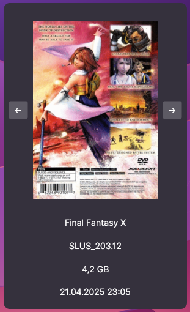
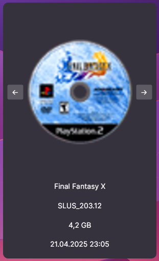

# OPLNova

[](https://img.shields.io/aur/version/oplnova)
[](https://img.shields.io/aur/version/oplnova-git)

## Overview

OPLNova is a modern, open-source alternative to OPL Manager designed to provide a more streamlined and user-friendly experience for managing your PS2 games with the Open PS2 Loader (OPL). This tool allows you to easily organize and manage your PS2 game collection, offering features such as cover art management, and more.

### Key Features:
- **Modern and Intuitive Interface**: A redesigned UI focused on ease of use, making managing PS2 games a smooth and enjoyable experience.
- **Open-Source**: OPLNova is completely open-source and free to use. Contributions are welcome, and the community plays a key role in its development.
- **CD/DVD Support**: OPLNova supports DVDs in ISO format and CDs in BIN/CUE format with its included BIN to ISO converter
- **Virtual Memory Cards Support**: Configure and manage virtual memory cards to store your game saves. (VMC's need to be created via OPL right now tho)
- **Mode Toggles**

## Screenshots

Here are a few screenshots showcasing the user interface and functionality of the program:

### General Overview of the Program


This screenshot showcases the main interface of OPLNova. It highlights the easy-to-navigate layout, with the ability to manage and organize your games in a modern, visually appealing way.

### Game Preview: Cover Art Display

<div style="display: flex; justify-content: space-between;">

  
  
  

</div>

This final screenshot provides another look at the selected game's cover art. It demonstrates the program’s ability to display multiple cover art variations for each game.

## Modern Design and UX

OPLNova was built with **modern design principles** in mind. We focused on creating an interface that feels familiar and intuitive, reducing the learning curve for new users while also providing advanced features for experienced users. The design prioritizes ease of use, clean aesthetics, and efficient workflow, allowing you to quickly find and manage your PS2 games.

### Some improvements include:
- **Simple and Clear Navigation**: The streamlined layout allows for quick access to all essential features.
- **Responsive Design**: The program adapts well to different screen sizes and resolutions, providing an optimal experience regardless of your device.
- **Optimized Performance**: With faster loading times and smooth transitions, the program ensures a seamless experience even with large game libraries.

## Disclaimer

This project does **NOT** support piracy in any form. Please ensure that all game images you use are legally obtained. We encourage users to only use game images that they have personally dumped from their own legally owned discs. The developers of this tool do not condone or support the use of illegally obtained game images.

## Installation

You can install **OPLNova** using one of the following methods:

### Option 1: Download Prebuilt Binaries

Prebuilt packages are available from the [CI builds](https://code.weexnes.dev/oplnova/~builds) (Linux x64 and Windows x64).

To use the AppImage (Linux Only!):

```bash
chmod +x OPLNova_Linux_x64.AppImage
./OPLNova_Linux_x64.AppImage
```

Or extract the `.zip` and run the `OPLNova` binary directly.

These builds are self-contained and do not require the .NET runtime.

---

### Option 2: Install via AUR (Arch Linux)

If you're using Arch Linux or a compatible distribution, you can install via the AUR:

Stable:
```bash
yay -S oplnova
```
Cutting Edge:
```bash
yay -S oplnova-git
```

This will build and install the latest version of OPLNova from source.

The resulting binary is self-contained and does not require the .NET runtime.


## Open Source

This project is **open-source**, and contributions are highly encouraged! If you're passionate about improving the PS2 gaming experience or if you have suggestions or improvements, feel free to contribute to the project.


We welcome **issues**, **pull requests**, and **feature suggestions** from the community. Help us make this tool even better for PS2 gamers!